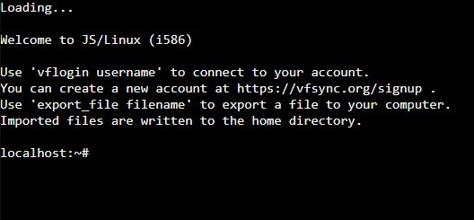
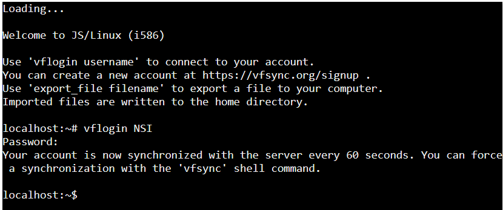
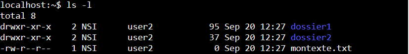

# TP - Utilisation d'une console shell

{{ initexo(0) }}

!!! success "Objectifs"
    Avec le jeu **Terminus**, vous avez découvert des commandes UNIX/Linux de façon ludique.
    Ce TP vous fait passer dans un **vrai terminal Linux**. À la fin, vous devez être autonome pour :

    - naviguer dans l'arborescence avec des chemins absolus et relatifs ;
    - créer, copier, déplacer et supprimer fichiers et dossiers ;
    - chercher dans un fichier, rediriger et enchaîner des commandes ;
    - lire et modifier les droits d'un fichier ;
    - éditer un fichier texte ;
    - exécuter un script et observer les processus.

## 1. Mise en route

Nous utilisons **JSLinux**, un ordinateur Linux simulé dans le navigateur.

1. Rendez-vous sur [https://bellard.org/jslinux](https://bellard.org/jslinux){:target="_blank"}
2. Cliquez sur **click here** sur la ligne **Alpine Linux** (console).



Après quelques secondes, l'invite de commande apparaît :

```text
localhost:~#
```

Le `#` indique que vous êtes **root**, l'administrateur : vous avez tous les droits.
Sur un vrai ordinateur, on ne travaille jamais en root : on utilise un compte ordinaire. Nous allons donc nous connecter avec un compte personnel.

3. Créez un compte sur [https://vfsync.org/signup](https://vfsync.org/signup){:target="_blank"} en choisissant un **nom d'utilisateur** et un **mot de passe**.

    

4. Dans le terminal, tapez `vflogin` suivi de votre nom d'utilisateur, par exemple `vflogin alice`, puis votre mot de passe.

    

L'invite devient :

```text
localhost:~$
```

Le `$` indique que vous êtes maintenant un **utilisateur ordinaire**, comme sur votre ordinateur. Votre dossier personnel `~` est **sauvegardé sur le serveur** : vous retrouverez vos fichiers à la prochaine séance en refaisant `vflogin`.

!!! warning "Mots de passe"
    Dans un terminal, le mot de passe **ne s'affiche pas** quand on le tape. C'est normal.

!!! warning "Ce qui n'est pas sauvegardé"
    Seul votre dossier personnel est sauvegardé. Tout le reste (le dossier `/tmp`, les utilisateurs créés…) disparaît quand vous fermez ou rechargez la page.

## 2. De Terminus à Linux

Les sorts de Terminus sont de vraies commandes Linux.

| Dans Terminus | Dans Linux | Remarque |
|---------------|------------|----------|
| `ls`, `cd`, `pwd` | `ls`, `cd`, `pwd` | identiques |
| `less OBJET` | `less fichier`, `cat fichier` | `less` permet de défiler (on quitte avec `q`), `cat` affiche tout d'un coup |
| `man SORT` | `man commande` | on quitte avec `q` |
| `help` | `commande --help` | aide courte d'une commande |
| `mv`, `cp`, `touch`, `rm`, `mkdir` | identiques | en plus : `rmdir` et `rm -r` pour les dossiers |
| `unzip SAC.zip` | `unzip archive.zip` | |
| `grep MOT OBJET` | `grep mot fichier` | |
| `sudo COMMANDE` | `sudo commande` | `sudo` n'existe pas dans JSLinux : on redevient root autrement (voir §5) |
| `whoami` | `whoami` | |

Comme dans Terminus, la touche **Tab** complète les noms et les flèches **↑ ↓** rappellent les commandes précédentes.

!!! example "{{ exercice() }}"
    1. Tapez `whoami`, puis `pwd`. Qui êtes-vous ? Où se trouve votre dossier personnel ?
    2. Tapez `ls /`. Retrouvez-vous des dossiers de Terminus ?
    3. Tapez `man ls` et cherchez à quoi sert l'option `-a`. Quittez avec `q`.

{{ correction(False,
"""
??? success \"Correction\"
    1. `whoami` affiche votre nom d'utilisateur vfsync, par exemple `alice`. Le dossier personnel est `/home/alice` : `pwd` affiche le chemin absolu, alors que l'invite l'abrège en `~`.
    2. On retrouve `bin`, `home`, `tmp`, `usr` et `var`, comme dans Terminus. Il y en a d'autres : `etc` (configuration), `dev` (périphériques), `proc`…
    3. `ls -a` affiche aussi les fichiers cachés, dont le nom commence par un point.
""") }}

## 3. L'arborescence et les chemins

### 3.1 La racine et les chemins

Sous Linux, tous les fichiers et dossiers forment **un seul arbre** dont la racine s'appelle `/`.

Un **chemin** indique l'emplacement d'un fichier ou d'un dossier dans cet arbre.

- Un **chemin absolu** part de la racine : il commence toujours par `/`.
  Il fonctionne quel que soit le dossier où l'on se trouve. Exemple : `/home/eleve/NSI/montexte.txt`
- Un **chemin relatif** part du dossier courant : il ne commence pas par `/`.
  Exemple : si l'on est dans `/home/eleve`, le chemin `NSI/montexte.txt` désigne le même fichier.

Quatre symboles à connaître :

| Symbole | Signification | Exemple |
|---------|---------------|---------|
| `/` | la racine (au début d'un chemin) ou le séparateur entre deux noms | `/home/eleve` |
| `.` | le dossier courant | `./script.sh` |
| `..` | le dossier parent | `cd ..`, `cat ../notes.txt` |
| `~` | le dossier personnel | `cd ~`, `~/NSI` |

!!! tip "Astuce"
    Utilisez souvent `pwd` pour vérifier où vous êtes. `cd` tout seul ramène au dossier personnel.

### 3.2 Les commandes

| Commande | Description |
|----------|-------------|
| `pwd` | affiche le chemin absolu du dossier courant |
| `ls` | liste le contenu du dossier |
| `ls -l` | liste en détail (droits, propriétaire, taille, date) |
| `ls -a` | affiche aussi les fichiers cachés |
| `cd dossier` | entre dans un dossier |
| `cd ..` | remonte au dossier parent |
| `cd ~` ou `cd` | retourne au dossier personnel |
| `mkdir dossier` | crée un dossier |
| `touch fichier.txt` | crée un fichier vide |
| `cp fichier1 fichier2` | copie un fichier |
| `mv fichier dossier` | déplace un fichier |
| `mv fichier1 fichier2` | renomme un fichier |
| `rm fichier` | supprime un fichier (définitivement !) |
| `rmdir dossier` | supprime un dossier **vide** |
| `rm -r dossier` | supprime un dossier et tout son contenu |

!!! example "{{ exercice() }}"
    1. Dans votre dossier personnel, créez l'arborescence suivante :

        ```text
        ~
        └── NSI
            ├── dossier1
            │   ├── fichier1.txt
            │   └── fichier2.txt
            ├── dossier2
            └── montexte.txt
        ```

    2. Donnez le chemin absolu de `fichier1.txt`.
    3. En étant dans `dossier2`, quelle commande affiche le contenu de `dossier1` sans changer de dossier ?

{{ correction(False,
"""
??? success \"Correction\"
    1. Une solution parmi d'autres :

        ```bash
        cd ~
        mkdir NSI
        cd NSI
        mkdir dossier1 dossier2
        touch montexte.txt dossier1/fichier1.txt dossier1/fichier2.txt
        ls -R
        ```

    2. `/home/alice/NSI/dossier1/fichier1.txt` si votre nom d'utilisateur est `alice` (vérifiez avec `pwd`).
    3. `ls ../dossier1` (chemin relatif) ou `ls ~/NSI/dossier1`.
""") }}

!!! example "{{ exercice() }}"
    1. Dans votre dossier personnel, créez un fichier `test.txt` et deux dossiers `livre1` et `livre2`.
    2. Dupliquez `test.txt` en `test1.txt` et `test2.txt`.
    3. Déplacez `test1.txt` dans `livre1`.
    4. Vérifiez le contenu de chaque dossier.
    5. Supprimez les deux dossiers `livre1` et `livre2`. Pourquoi `rmdir livre1` ne fonctionne-t-il pas ?

{{ correction(False,
"""
??? success \"Correction\"
    ```bash
    cd ~
    touch test.txt
    mkdir livre1 livre2
    cp test.txt test1.txt
    cp test.txt test2.txt
    mv test1.txt livre1
    ls
    ls livre1 livre2
    rmdir livre2        # livre2 est vide : ça marche
    rm -r livre1        # livre1 contient test1.txt
    ```

    `rmdir` ne supprime que les dossiers vides. Or `livre1` contient `test1.txt` : il faut `rm -r`.
""") }}

## 4. Chercher, rediriger, enchaîner

### 4.1 Écrire dans un fichier : les redirections `>` et `>>`

Normalement, une commande affiche son résultat à l'écran. Le symbole `>` **redirige** ce résultat vers un fichier.

| Commande | Effet |
|----------|-------|
| `echo Bonjour` | affiche `Bonjour` à l'écran |
| `echo Bonjour > f.txt` | écrit `Bonjour` dans `f.txt` (le contenu précédent est **écrasé**) |
| `echo Salut >> f.txt` | **ajoute** `Salut` à la fin de `f.txt` |
| `ls / > liste.txt` | enregistre le résultat de `ls /` dans `liste.txt` |
| `cat f1.txt f2.txt > fusion.txt` | met bout à bout (concatène) deux fichiers dans un troisième |
| `cat > f.txt` | écrit dans `f.txt` tout ce que vous tapez au clavier, jusqu'à **Ctrl + D** |

!!! note "Ctrl + D"
    `Ctrl + D` signifie « fin de fichier » (EOF, *End Of File*). C'est ainsi qu'on termine une saisie au clavier.

### 4.2 Chercher avec `grep`

Comme dans la Bibliothèque de Terminus, `grep` affiche les lignes d'un fichier qui contiennent un mot.

| Commande | Effet |
|----------|-------|
| `grep mot fichier` | affiche les lignes contenant `mot` |
| `grep -i mot fichier` | sans tenir compte des majuscules |
| `grep -n mot fichier` | avec les numéros de ligne |
| `grep -c mot fichier` | compte les lignes |
| `grep mot *.txt` | cherche dans tous les fichiers `.txt` du dossier |

### 4.3 Enchaîner avec le tube `|`

Le **tube** `|` envoie le résultat d'une commande à la commande suivante.

```bash
ls -l /bin | grep sh        # parmi les programmes de /bin, ceux dont le nom contient sh
ls /bin | grep -c ''        # compte les programmes de /bin
```

!!! example "{{ exercice() }}"
    1. Créez le fichier `livre.txt` avec ces trois lignes, sans éditeur, avec `echo` et des redirections :

        ```text
        Le magicien Magus menace Terminus.
        Le village est paisible.
        Magus a disparu.
        ```

    2. Affichez les lignes qui contiennent `Magus`, avec leur numéro.
    3. Combien de lignes contiennent `magus`, sans tenir compte des majuscules ?
    4. Enregistrez dans `racine.txt` la liste des dossiers de `/`, puis affichez seulement ceux qui contiennent la lettre `r`, à l'aide d'un tube.

{{ correction(False,
"""
??? success \"Correction\"
    ```bash
    echo Le magicien Magus menace Terminus. > livre.txt
    echo Le village est paisible. >> livre.txt
    echo Magus a disparu. >> livre.txt
    grep -n Magus livre.txt          # lignes 1 et 3
    grep -ic magus livre.txt         # 2
    ls / > racine.txt
    cat racine.txt | grep r          # ou directement : grep r racine.txt
    ```

    Attention : le premier `echo` utilise `>`, les suivants `>>`. Avec `>` à chaque fois, il ne resterait que la dernière ligne.
""") }}

## 5. Les utilisateurs et les droits

### 5.1 Lire les droits

Les systèmes UNIX sont **multi-utilisateurs** : chaque utilisateur a ses fichiers et ses droits.
L'administrateur, **root**, a tous les droits. C'est le « mot de passe sudo » de Terminus.
Pour simplifier la gestion, les utilisateurs sont réunis en **groupes**.

La commande `ls -l` affiche les droits :



De gauche à droite : **droits, nombre de liens, propriétaire, groupe, taille en octets, date, heure, nom**.
Dans cet exemple, le propriétaire est *NSI* et le groupe *user2*.

Les droits s'écrivent avec 10 caractères, par exemple `-rw-r--r--` :

- le 1er caractère donne le type : `-` pour un fichier, `d` pour un dossier ;
- puis trois groupes de trois lettres : les droits du **propriétaire**, du **groupe**, et des **autres**.

| Lettre | Sur un fichier | Sur un dossier |
|--------|----------------|----------------|
| `r` | lire le contenu | lister le contenu (`ls`) |
| `w` | modifier le contenu | créer ou supprimer des fichiers dedans |
| `x` | exécuter (programme, script) | entrer dedans (`cd`) |
| `-` | droit absent | droit absent |

Pour `-rw-r--r--` : c'est un fichier ; le propriétaire peut le lire et le modifier ; le groupe et les autres peuvent seulement le lire.

### 5.2 Modifier les droits avec `chmod`

Chaque groupe de trois droits s'écrit en **binaire** : 1 si le droit est présent, 0 sinon.

| Droits | Binaire | Chiffre |
|--------|---------|---------|
| `rwx` | `111` | 7 |
| `rw-` | `110` | 6 |
| `r-x` | `101` | 5 |
| `r--` | `100` | 4 |
| `---` | `000` | 0 |

Ainsi `chmod 640 fichier` donne les droits `rw-r-----`.

### 5.3 Passer en root pour administrer

Certaines opérations sont réservées à root : créer un utilisateur, changer le propriétaire d'un fichier, modifier les fichiers des autres…

Sur un vrai ordinateur, on tape `sudo` devant la commande, comme dans Terminus. Dans JSLinux, `sudo` n'est pas installé. Mais votre session a été ouverte **depuis** la session root du départ : il suffit de la quitter pour redevenir root.

| Commande | Effet |
|----------|-------|
| `exit` | quitte votre session : vous redevenez root (l'invite passe de `$` à `#`) |
| `adduser -D invite` | (root) crée l'utilisateur `invite`, sans mot de passe |
| `su - invite` | (root) devient `invite` et va dans son dossier `/home/invite` |
| `exit` | quitte la session d'`invite` : retour à root |
| `vflogin nom` | retour à votre propre session |

!!! warning "Pensez à revenir à votre session"
    Tant que vous êtes root, votre dossier personnel n'est plus sauvegardé. Refaites `vflogin` dès que vous avez fini les opérations d'administration.

!!! example "{{ exercice() }}"
    1. Dans votre session (`$`), tapez :

        ```bash
        cd /tmp
        echo Bonjour > note.txt
        ls -l note.txt
        adduser -D invite
        ```

        Quels sont les droits de `note.txt` ? Qui en est le propriétaire ? Pourquoi `adduser` échoue-t-il ?

    2. Retirez au groupe et aux autres le droit de lire `note.txt`. Avez-vous eu besoin d'être root ? Pourquoi ?
    3. Tapez `exit` pour redevenir root, vérifiez avec `whoami`, puis créez l'utilisateur `invite`.
    4. Devenez `invite` (`su - invite`), puis essayez :

        ```bash
        cat /tmp/note.txt
        ls /home
        ls /home/alice          # remplacez alice par votre nom d'utilisateur
        ```

        Expliquez chaque résultat. Puis tapez `exit` pour revenir à root.

    5. En root, faites d'`invite` le propriétaire de `note.txt` (`chown --help` vous aidera). Vérifiez qu'`invite` peut maintenant le lire. Pourquoi ne pouviez-vous pas faire cela dans votre session ?
    6. En root, créez un dossier `/tmp/coffre` et donnez-lui les droits `rwxrw-r--`. `invite` peut-il y entrer avec `cd` ? Pourquoi ?
    7. Quel chiffre faut-il pour que le propriétaire puisse tout faire, le groupe lire et exécuter, et les autres seulement exécuter ?
    8. Revenez à votre session avec `vflogin`.

{{ correction(False,
"""
??? success \"Correction\"
    1. `-rw-r--r--` : vous êtes le propriétaire, vous pouvez lire et écrire ; le groupe et les autres peuvent seulement lire. `adduser` échoue car seul root peut créer un utilisateur.
    2. `chmod 600 note.txt` donne `rw-------`. Pas besoin d'être root : **le propriétaire** d'un fichier peut toujours en changer les droits.
    3. `exit`, puis `whoami` affiche `root`, puis `adduser -D invite`.
    4. `cat /tmp/note.txt` donne **Permission denied** : depuis la question 2, les autres n'ont plus aucun droit sur ce fichier.
    `ls /home` montre les dossiers personnels (le vôtre et celui d'`invite`).
    `ls /home/alice` est sans doute refusé : un dossier personnel est en général fermé aux autres utilisateurs (vérifiez ses droits avec `ls -l /home`).
    5. `chown invite /tmp/note.txt`. Les droits `rw-` du propriétaire s'appliquent maintenant à `invite`, qui peut lire le fichier. Seul root peut donner un fichier à quelqu'un d'autre : sinon, chacun pourrait attribuer ses fichiers aux autres.
    6. `mkdir /tmp/coffre` puis `chmod 764 /tmp/coffre`. Pour les autres, les droits sont `r--` : pas de `x`, donc `invite` ne peut pas entrer dans le dossier avec `cd`.
    7. `rwx r-x --x` donne `111 101 001`, soit **751**.
    8. `vflogin alice`, puis le mot de passe.
""") }}

## 6. Éditer un fichier avec `vi`

L'éditeur de texte présent sur tous les systèmes UNIX est `vi`. Il fonctionne avec **deux modes** :

- le **mode commande** (au démarrage) : les touches donnent des ordres ;
- le **mode insertion** : on tape du texte.

| Touches | Action |
|---------|--------|
| `vi fichier.txt` | ouvre (ou crée) le fichier |
| `i` | passe en mode insertion : on peut écrire |
| `Échap` | revient au mode commande |
| `:w` puis Entrée | enregistre |
| `:wq` puis Entrée | enregistre et quitte |
| `:q!` puis Entrée | quitte **sans** enregistrer |

!!! tip "Perdu dans vi ?"
    Appuyez sur `Échap`, puis tapez `:q!` et Entrée : vous sortez sans rien modifier.

!!! example "{{ exercice() }}"
    1. Ouvrez `montexte.txt` avec `vi`, écrivez deux lignes de texte, enregistrez et quittez.
    2. Vérifiez le contenu du fichier avec `cat`.
    3. Rouvrez-le, ajoutez une ligne, puis quittez **sans** enregistrer. Vérifiez avec `cat`.

## 7. Scripts et processus

Un **processus** est un programme en cours d'exécution. Chacun a un numéro, le **PID**.

| Commande | Effet |
|----------|-------|
| `python3 essai.py` | exécute un script Python |
| `python3` | ouvre l'interpréteur Python (on en sort avec `exit()` ou **Ctrl + D**) |
| `commande &` | lance la commande **en arrière-plan** : le terminal reste disponible |
| `ps` | liste les processus et leur PID |
| `top` | affiche les processus en temps réel (on quitte avec `q`) |
| `kill PID` | demande au processus de s'arrêter |
| `kill -9 PID` | arrête le processus immédiatement, sans discussion |
| **Ctrl + C** | interrompt la commande en cours |

!!! danger "Attention"
    `kill -9` détruit le processus sans lui laisser le temps de s'arrêter proprement. On ne l'utilise qu'en dernier recours.

!!! example "{{ exercice() }}"
    1. Avec `vi` (ou `cat >`), créez le script `compte.py` :

        ```python
        for i in range(20):
            print(i)
        ```

        Exécutez-le.

    2. Créez le script `boucle.py`, qui ne s'arrête jamais :

        ```python
        import time
        while True:
            time.sleep(1)
        ```

        Lancez-le avec `python3 boucle.py`. Le terminal ne répond plus : arrêtez le script avec **Ctrl + C**.

    3. Relancez-le en arrière-plan avec `python3 boucle.py &`. Retrouvez son PID avec `ps`, puis arrêtez-le avec `kill`. Vérifiez avec `ps` qu'il a disparu.
    4. Lancez `top`. Quel processus utilise le plus le processeur ? Quittez avec `q`.

{{ correction(False,
"""
??? success \"Correction\"
    ```bash
    vi compte.py               # i, on tape le script, Échap, :wq
    python3 compte.py          # affiche 0 à 19
    vi boucle.py
    python3 boucle.py          # Ctrl + C pour l'arrêter
    python3 boucle.py &        # le terminal affiche un numéro de tâche et le PID
    ps                         # repérer la ligne python3 boucle.py et son PID
    kill 123                   # remplacer 123 par le PID trouvé
    ps                         # la ligne a disparu
    top                        # q pour quitter
    ```
""") }}

## 8. Travail à rendre

Seul l'exercice suivant est à rendre.

!!! example "{{ exercice() }} — À rendre"
    On considère l'arborescence suivante :

    ```text
    /
    ├── bin
    │   ├── bash
    │   └── cat
    ├── home
    │   ├── alice
    │   └── bob
    │       ├── documents
    │       │   ├── images
    │       │   │   └── logo.png
    │       │   ├── musique
    │       │   │   ├── classique
    │       │   │   └── rock
    │       │   │       ├── track1.mp3
    │       │   │       └── track2.mp3
    │       │   ├── videos
    │       │   └── mon_roman.docx
    │       └── tmp
    ├── etc
    └── usr
    ```

    1. Si je suis dans `documents`, qu'affiche `pwd` ?
    2. Depuis `images`, donnez deux commandes différentes qui permettent d'aller dans `musique`.
    3. Quelle est la différence entre `cp test1.txt test2.txt` et `mv test1.txt test2.txt` ?
    4. Depuis `documents`, que se passe-t-il avec `rm videos` ? Quelle commande faut-il utiliser ?
    5. Depuis `documents`, quelle commande supprime le dossier `rock` et son contenu ?
    6. Quelle commande affiche les droits de `mon_roman.docx` ?
    7. Quelle commande permet que seul le propriétaire puisse lire et modifier `mon_roman.docx` (sans exécution) ?
    8. Comment créer un fichier texte et écrire dedans ? Donnez deux méthodes.
    9. Comment exécuter le script `prog.py` ?
    10. Quelle commande affiche les processus en cours ?

{{ correction(False,
"""
??? success \"Correction\"
    1. `/home/bob/documents`
    2. `cd ../musique` (chemin relatif) ou `cd /home/bob/documents/musique` (chemin absolu). Si l'on est connecté en tant que bob : `cd ~/documents/musique`.
    3. `cp` crée une copie : les deux fichiers existent. `mv` renomme : `test1.txt` n'existe plus, il s'appelle désormais `test2.txt`.
    4. `rm` refuse : `videos` est un dossier (message *Is a directory*). Il faut `rmdir videos` (le dossier est vide) ou `rm -r videos`.
    5. `rm -r musique/rock`
    6. `ls -l mon_roman.docx` (depuis `documents`)
    7. `chmod 600 mon_roman.docx` (droits `rw-------`)
    8. Avec l'éditeur : `vi fichier.txt`. Avec une redirection : `echo texte > fichier.txt` ou `cat > fichier.txt` (terminer par Ctrl + D).
    9. `python3 prog.py`
    10. `ps` (liste) ou `top` (en temps réel)
""") }}
