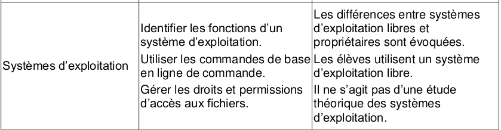
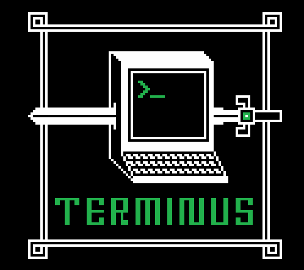
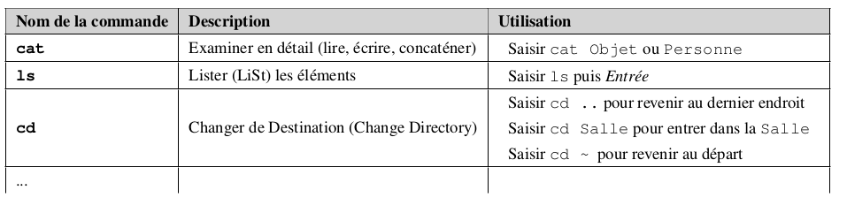
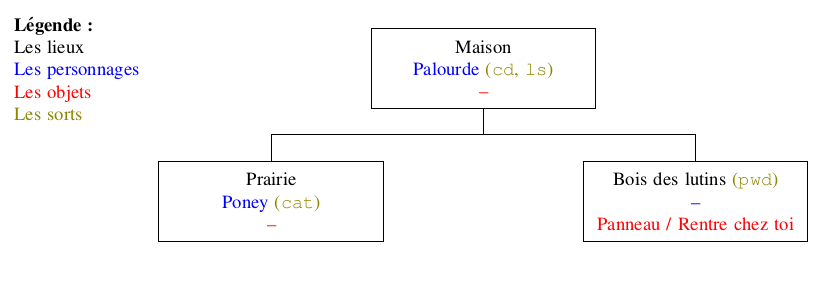
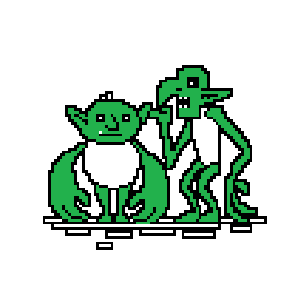

# 3.3 Découverte des commandes UNIX

{: .center}

À partir du jeu Terminus.

{: .center}


Rendez-vous à l'adresse : [Terminus](data/Terminus_version_corrigée.html){:target="_blank"}

!!! warning "Sauvegarde"man ls
    Le jeu reprend automatiquement là où vous vous êtes arrêté, **sur le même navigateur**.
    Sur les ordinateurs du lycée, cette sauvegarde peut être effacée : **à la fin de chaque séance**,
    tapez `sauver` et recopiez le code obtenu (ex. `1YZZ-ZZ04-Y0KF3`) en haut de votre feuille.
    Pour reprendre, tapez `charger` suivi de votre code.

Laissez-vous guider par le jeu, mais **ATTENTION** !  

- Vous devez noter sur feuille ou sur un document numérique chaque nouvelle commande que vous apprenez. Vous pouvez par exemple construire un tableau de ce type :

{: .center}
[modèle téléchargeable](data/VotreNom_commandes_Linux.docx)

- Sur une (plusieurs) copies doubles en mode paysage ou à l'aide du modèle *drawio* donné, établir un plan du jeu **au fur et à mesure** que vous avancez dans votre quête. Par exemple :  

[modèle téléchargeable](data/VotreNom_Plan_Terminus.drawio)  
[lien de l'application drawio](https://app.diagrams.net/?src=about)
{: .center}

!!! success "Fin du jeu"
    Le jeu est terminé lorsque vous lisez le **Certificat** du Paradis.
    Faites une capture d'écran du certificat et joignez-la à votre tableau et à votre plan.

## Questions de clôture

Votre plan du jeu est en réalité une **arborescence de fichiers** Linux : les lieux sont des dossiers, les objets et les personnages sont des fichiers.

!!! question "Questions"
    1. Donnez le chemin absolu de la Bibliothèque.
    2. Depuis la Clairière, quelle commande `cd` **relative** mène à la PlaceDuVillage ?
    3. Quel est le rôle des dossiers `/home`, `/var` et `/usr` dans le jeu ? Et dans un vrai système Linux ?

{{ correction(True,
"""
??? success \"Correction\"
    **1.** `/var/PlaceDuVillage/Bibliothèque`

    Un chemin absolu part de la racine `/`. On peut le vérifier dans le jeu en tapant `pwd` dans la Bibliothèque.

    **2.** `cd ../..`

    `..` désigne le dossier parent : depuis la Clairière, un premier `..` mène au PontCassé, un second à la PlaceDuVillage.
    La commande `cd /var/PlaceDuVillage` y mène aussi, mais c'est un chemin absolu, pas relatif.

    **3.**

    | Dossier | Dans le jeu | Dans Linux |
    |---------|-------------|------------|
    | `/home` | Contient `Départ`, le point de départ du joueur. `~` est un raccourci pour `/home/Départ`. | Contient les dossiers personnels des utilisateurs (ex. `/home/eleve`). `~` désigne le dossier personnel de l'utilisateur connecté. |
    | `/var` | Contient le village (`PlaceDuVillage`), un lieu qui change sans cesse : on y crée, déplace et supprime des objets. | Contient les données **variables**, qui changent pendant que le système tourne : journaux (`/var/log`), sites web (`/var/www`), files d'attente… |
    | `/usr` | Contient `/usr/src/FichiersNoyau`, les « sources du monde », protégées en écriture : il faut `sudo` pour y lire le Certificat. | Contient les programmes et bibliothèques installés, partagés par tous les utilisateurs et non modifiables sans droits d'administrateur. `/usr/src` contient les sources, notamment celles du noyau Linux. |

    On retrouve aussi `/bin` (les commandes apprises, qui sont des programmes) et `/tmp` (un dossier temporaire où tout le monde peut écrire).
""") }}


{: .center}

{{ correction(True,
"""
## Corrigé du jeu

??? success \"Historique des commandes\"
    Une partie complète, avec les 7 quêtes réussies. Le mot de passe sudo est `sesame`.

    ```bash
    # ===== Chapitre 1 : /home/Départ =====
    ls
    less Noisette
    cd Prairie
    less Poney                    # le chemin Montagnes apparaît
    cd Montagnes
    less VieilHomme               # il laisse un Manuscrit
    less Manuscrit                # apprend man
    man ls
    cd ~
    cd Bois
    less Panneau
    less RentreChezToi
    cd AcadémieDesBots/Cours
    less Professeur               # apprend mv
    cd ../SalleDEntrainement
    less Note
    mv Pilier1 Boîte
    mv Pilier2 Boîte
    mv Pilier3 Boîte              # l'académie s'écroule
    cd ~
    cd Prairie/Montagnes/Cave/SombreCorridor/PièceHumide
    less Rocher
    mv Rocher PetiteCrevasse      # QUÊTE 1 : le Tunnel apparaît
    cd Tunnel
    less TouffeDePoils            # c'est un Rat
    cd ChambreDePierre/Portail
    cd Terminus                   # lien vers /var/PlaceDuVillage
    pwd

    # ===== Chapitre 2 : /var/PlaceDuVillage =====
    ls
    less Villageois               # il s'appelle Jasper
    less VieuxLecteur
    less VillageoiseEnPleurs
    cd BoutiqueArtisanale
    less Artisane                 # apprend touch
    touch rouage
    less Artisane                 # apprend cp
    cp rouage rouage1
    cp rouage rouage2
    cp rouage rouage3
    cp rouage rouage4
    cp rouage rouage5             # QUÊTE 2
    less Artisane
    cd ../PlaceDuMarché
    less SacADos                  # apprend unzip, devient SacADos.zip
    unzip SacADos.zip             # Bourse10000 et Bourse5000
    less Vendeur
    1                             # achète mkdir (5000)
    less Vendeur
    1                             # achète rm (10000)
    cd ../CheminEnPierres
    rm EnormeRocher               # la Ferme apparaît
    cd Ferme
    less Fermier
    cp EpisDeMais AutreEpisDeMais # QUÊTE 3
    cd ../../Bibliothèque
    less IntrigantPanneau         # la PièceSecrète apparaît
    cd PièceSecrète
    less Bibliothécaire
    less Grep                     # apprend grep
    cd ..
    grep Magus HistoireDeTerminus # QUÊTE 5
    cd ../PontCassé
    touch Planche                 # le pont est réparé
    cd Clairière
    less HommeEnPleurs
    mkdir Maison                  # QUÊTE 4
    cd CheminInquiétant
    rm RoncesTordues              # la CaveDesTrolls apparaît
    cd CaveDesTrolls
    less TrollPlusMoche
    rm TrollMoche
    cd Toboggan
    ls
    cd FichiersNoyau              # lien vers /usr/src/FichiersNoyau
    pwd

    # ===== Chapitre 3 : /usr/src/FichiersNoyau =====
    less Instructions             # apprend sudo
    cd PlusDeFichiersNoyau
    grep password= *              # S.txt contient password=sesame
    sudo ls                       # mot de passe : sesame, le Paradis apparaît
    cd /var/PlaceDuVillage/PontCassé/Clairière/CheminInquiétant/CaveDesTrolls
    sudo rm TrollAbsolumentHideux # QUÊTE 6
    mv Cage/EnfantKidnappé ..     # QUÊTE 7
    cd /usr/src/FichiersNoyau/Paradis
    sudo less Certificat          # fin du jeu : 7 / 7
    ```

??? success \"Tableau des commandes\"
    | Commande | Où l'apprend-on ? | Rôle | Exemple |
    |----------|-------------------|------|---------|
    | `ls` | dès le départ | lister le contenu d'un dossier | `ls`, `ls Prairie`, `ls /` |
    | `cd` | dès le départ | changer de dossier | `cd Bois`, `cd ..`, `cd ~`, `cd /`, `cd -` |
    | `pwd` | dès le départ | afficher le chemin absolu du dossier courant | `pwd` |
    | `less` / `cat` | dès le départ | afficher le contenu d'un fichier | `less Poney` |
    | `help` | dès le départ | lister les commandes connues | `help` |
    | `clear` | dès le départ | effacer l'écran | `clear` |
    | `man` | Montagnes (Manuscrit) | afficher le manuel d'une commande | `man cd` |
    | `mv` | AcadémieDesBots/Cours (Professeur) | déplacer ou renommer un fichier | `mv Rocher PetiteCrevasse` |
    | `touch` | BoutiqueArtisanale (Artisane) | créer un fichier vide | `touch rouage` |
    | `cp` | BoutiqueArtisanale (Artisane) | copier un fichier | `cp rouage rouage1` |
    | `unzip` | PlaceDuMarché (SacADos) | décompresser une archive .zip | `unzip SacADos.zip` |
    | `mkdir` | PlaceDuMarché (Vendeur) | créer un dossier | `mkdir Maison` |
    | `rm` | PlaceDuMarché (Vendeur) | supprimer définitivement un fichier | `rm EnormeRocher` |
    | `grep` | Bibliothèque/PièceSecrète (Grep) | chercher les lignes contenant un mot | `grep Magus HistoireDeTerminus`, `grep password= *` |
    | `sudo` | FichiersNoyau (Instructions) | exécuter une commande en administrateur (root) | `sudo less Certificat` |
    | `whoami` | avec sudo | afficher le nom de l'utilisateur | `whoami`, `sudo whoami` |
    | `history` | dès le départ | afficher les commandes déjà tapées | `history` |

    À retenir aussi :

    - `..` désigne le dossier parent, `~` le dossier personnel, `/` la racine ;
    - `*` désigne tous les fichiers du dossier courant ;
    - la touche Tab complète les noms, les flèches ↑ ↓ parcourent l'historique.

??? success \"Arbre du jeu\"
    Les noms terminés par `/` sont des dossiers (lieux). Les autres sont des fichiers (objets et personnages).
    Les noms terminés par `@` sont des liens symboliques. Les noms entre crochets apparaissent ou sont créés pendant la partie.

    ```text
    /
    ├── bin/                              (les commandes apprises)
    ├── home/
    │   └── Départ/                       (~, point de départ)
    │       ├── Noisette
    │       ├── Poussière
    │       ├── Prairie/
    │       │   ├── Poney
    │       │   └── [Montagnes/]
    │       │       ├── VieilHomme  →  [Manuscrit]
    │       │       └── Cave/
    │       │           └── SombreCorridor/
    │       │               └── PièceHumide/
    │       │                   ├── Rocher
    │       │                   ├── PetiteCrevasse/
    │       │                   └── [Tunnel/]
    │       │                       ├── TouffeDePoils  (Rat)
    │       │                       └── ChambreDePierre/
    │       │                           └── Portail/
    │       │                               └── Terminus@  →  /var/PlaceDuVillage
    │       └── Bois/
    │           ├── Panneau
    │           ├── RentreChezToi
    │           ├── Gribouillis
    │           └── AcadémieDesBots/
    │               ├── Cours/
    │               │   └── Professeur
    │               └── SalleDEntrainement/
    │                   ├── Note
    │                   ├── Pilier1, Pilier2, Pilier3
    │                   └── Boîte/
    ├── tmp/                              (dossier d'entraînement)
    ├── usr/
    │   └── src/
    │       └── FichiersNoyau/
    │           ├── Instructions
    │           ├── PlusDeFichiersNoyau/
    │           │   └── L.txt  M.txt  P.txt  Q.txt  R.txt  S.txt  T.txt  U.txt  V.txt  W.txt
    │           └── [Paradis/]
    │               └── Certificat        (protégé : sudo)
    └── var/
        └── PlaceDuVillage/
            ├── Villageois  (Jasper)
            ├── VieuxLecteur
            ├── VillageoiseEnPleurs
            ├── BoutiqueArtisanale/
            │   ├── Dragon
            │   ├── BabioleÉtrange
            │   ├── Artisane
            │   └── [rouage, rouage1 … rouage5]
            ├── PontCassé/
            │   ├── [Planche]
            │   └── Clairière/
            │       ├── HommeEnPleurs
            │       ├── [Maison/]
            │       ├── [Enfant]
            │       └── CheminInquiétant/
            │           ├── RoncesTordues
            │           └── [CaveDesTrolls/]
            │               ├── TrollMoche
            │               ├── TrollPlusMoche
            │               ├── TrollAbsolumentHideux
            │               ├── Cage/
            │               │   └── EnfantKidnappé
            │               └── Toboggan/
            │                   └── FichiersNoyau@  →  /usr/src/FichiersNoyau
            ├── Bibliothèque/
            │   ├── SuperLivreDesSortilèges
            │   ├── RomanceDePoche
            │   ├── HistoireDeTerminus
            │   ├── NostalgieDuPays
            │   ├── VIMproved
            │   ├── IntrigantPanneau
            │   └── [PièceSecrète/]
            │       ├── Bibliothécaire
            │       └── Grep
            ├── PlaceDuMarché/
            │   ├── Vendeur
            │   ├── SacADos  →  [Bourse10000, Bourse5000]
            │   ├── mkdir
            │   └── rm
            └── CheminEnPierres/
                ├── EnormeRocher
                └── [Ferme/]
                    ├── Fermier
                    ├── EpisDeMais
                    └── [AutreEpisDeMais]
    ```
""") }}
